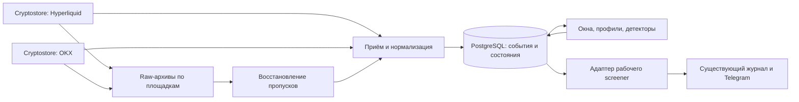

# «Пульс рынка»: конкретный план реализации v2

Дата: 6 ноября 2026 года. Основание: живой пилот Hyperliquid + OKX, BTC/XRP, 10 576 сохранённых исполнений, проверка по PCAP, разрыв TCP, рестарт сборщика и потребителя. План заменяет предварительный вариант. Это план следующих работ, а не заявление об их выполнении.

## 1. Что принимаем и что меняем после пилота

| Вопрос | Решение v2 | Основание |
|---|---|---|
| Сборщик | Cryptostore отдельным сервисом; закреплённый образ пилота | Сбор, raw-архив и поток проверены живьём |
| Внешняя площадка | OKX первой; Binance/Bybit отложены до отдельной проверки допустимого доступа с целевого хоста | OKX работает; из исследованного окружения другие две площадки ограничили доступ |
| Изоляция отказов | Отдельный контейнер на каждую биржу | В пилоте один рестарт затрагивал обе площадки |
| Передача данных | TCP — оперативный канал, не гарантированный журнал | Разрыв потребителя оставляет пропуск; сервер не предоставляет проверенный durable cursor |
| Постоянное хранение | Отдельный сервис приёма + PostgreSQL для новых событий/агрегатов | Нужны идемпотентность, устойчивые курсоры и чтение несколькими процессами; SQLite пилота остаётся доказательством |
| Существующая система | Hub, текущий SQLite-журнал, Telegram и пакет фактов сохраняются | Пилот не проверял интеграцию в рабочий screener; переписывание не требуется |
| Детекторы первой версии | Локальное ускорение, квантили, MAD, простая оценка движения/потока | Сначала объяснимые признаки и репрезентативная история |
| River и сложные модели | Эксперимент после базовой версии | Их преимущество на наших данных пока не доказано |
| Готовность | Подтверждён ограниченный технический сбор; полнота биржевого потока и качество сигналов не подтверждены | Только четыре сопоставимые межбиржевые пары минут |

## 2. Целевая схема и границы ответственности

Это логические роли, не требование запускать отдельный контейнер для каждого прямоугольника. В первой версии приём, восстановление и расчёты могут быть одним приложением с разными командами/задачами. Отдельными процессами остаются сборщики площадок, БД и действующий screener. Kafka и Redis не являются обязательными зависимостями.

Для новой аналитики единственным источником детальных Hyperliquid-сделок станет новый непрерывный collector. Нынешний Hub продолжает legacy-наблюдение и широкий обзор. Их события не складываются. Временные параллельные подписки ограничиваем BTC/XRP; перенос владения потоками Hub — отдельный последующий этап, если измерения покажут необходимость.

Стартовый набор фиксирован: BTC и XRP на обеих площадках. Сбор идёт независимо от динамических слотов внимания. Непокрытые инструменты не получают заявление о межбиржевом подтверждении. Расширение набора — после проверки ресурсов и устойчивости.

## 3. Контракт данных — до добавления новых индикаторов

### Инструмент

Хранить: площадку, нативный ID, базовый актив, тип рынка, валюту котировки и расчёта, linear/inverse, размер контракта, доступный множитель и версию спецификации с временем действия. V1 поддерживает только явно проверенные линейные бессрочные контракты. Спот и inverse-контракты автоматически в тот же ряд не включаются.

Изменение спецификации создаёт новую версию. Воспроизведение использует версию, действовавшую для события, а не сегодняшнее значение contractSize. При неизвестной единице объёма событие сохраняется, но расчёт notional блокируется.

### Исполнение

Минимальные поля: schema_version, venue, native_market_id, channel, aggregation_kind, trade_id, event_time, receive_time, source_epoch, side, native_amount, base_amount, quote_amount, instrument_spec_version, ссылка на исходное сообщение.

Цены и размеры — Decimal/NUMERIC; UTC-время — целочисленное с явной единицей. Денежные расчёты не переводить в float ради хранения. Проценты можно округлять только при показе.

**Один канонический канал на инструмент:** OKX trades-all; Hyperliquid trades. CCXT trades используется для проверки или восстановления только после проверки семантики. Агрегированный trades и trades-all нельзя объединять по последнему tradeId: в пилоте одна запись соответствовала четырём исполнениям.

Ключ повтора содержит площадку, рынок и каноническую семантику канала/ID. Совпавший ключ с другими размером, ценой, стороной или временем — конфликт, а не молчаливый INSERT OR IGNORE. Сохранить обе версии в журнале конфликтов и исключить затронутые окна до разбора. Разные aggregation_kind разделить, а не считать независимыми исполнениями.

## 4. Полнота, хранение и восстановление

Совпадение 10 576 записей с PCAP доказывает правильность обработки сохранённой выборки. Оно не доказывает, что биржа доставила все исполнения. Эту границу сохраняем в документации и UI.

### Устойчивый путь

1. Сохранить полученное событие и его проверенную нормализацию в транзакции БД.
2. Только после commit разрешать расчёт затронутых окон. Контрольный курсор расчётчика хранить устойчиво.
3. При повторе доставки транзакция не создаёт второе исполнение.
4. Raw-архив нужен для аудита и восстановления; он не подменяет устойчивый журнал нормализованных событий.

В V1 один writer нормализованных событий. Событие, конфликт/результат дедупликации и запись о необходимости пересчёта фиксируются атомарно. Курсор клиента должен обозначать устойчиво опубликованную последовательность, а не произвольное время события. Параллельную запись несколькими воркерами не включать без проверки порядка commit и отсутствия пропуска запоздало зафиксированных записей.

Сборщик не получает от нашего приложения подтверждения долговременной записи каждого TCP-сообщения. Поэтому участок между последней подтверждённой записью и восстановлением подписки считается потенциальным пропуском. Устранение этого участка требует сверки с raw/историей; стабильный TCP сам по себе не делает его полным.

### Состояния

| Состояние | Что означает | Использование |
|---|---|---|
| warming_up | Полное окно ещё не накоплено | Факты доступны с оговоркой; подтверждение блокируется |
| observed_no_detected_gap | Нет обнаруженного разрыва при выполнении проверок | Можно сравнивать, но без обещания абсолютной биржевой полноты |
| gap_detected | Есть известный или предполагаемый пропуск | Не использовать для нормы/подтверждения |
| recovering | Идёт восстановление | Не выдавать восстановленные данные за live |
| reconciled | Доступный участок восстановлен и проверен выбранным методом | Сохранять метод и границы сверки |
| unavailable | Нет пригодного источника | Показывать недоступность, не нулевую активность |

Свежий стакан не доказывает исправность канала сделок. Состояние и heartbeat отслеживать отдельно по площадке, каналу и подписке. Отсутствие сделок при живом подтверждённом канале отличать от отсутствия данных. Контейнерный health — только один из входов.

### Восстановление

- После рестарта/разрыва сохранять gap с границами и source_epoch.
- Восстанавливать сначала из доступного raw, затем из совместимого исторического источника с перекрытием и дедупликацией. Не предполагать непрерывность или арифметическую последовательность tradeId без документации конкретного канала.
- Старые сообщения при подписке не отбрасывать только по условию event_time < session_start, как в пилоте. Сохранять, дедуплицировать и относить к восстановлению; не выдавать за новое рыночное событие.
- Если восстановить участок нельзя, оставить gap. Пересобрать чистые окна после него.
- Проверить аварийный обрыв записи PCAP: читаемый префикс, ротацию, контрольные суммы. Пилот проверял закрытые файлы после штатных остановок.
- Повторные подключения: задержка с нарастанием и jitter, отдельный лимит; после открытия сокета ждать подтверждения подписки/данных. Устранение быстрых EOF-повторов из пилота проверить новым отказным тестом.

## 5. Единые окна и обработка времени

V1 сравнивает календарные минуты UTC вида [t, t+60). Раннее скользящее окно 60 секунд остаётся отдельным признаком; не сравнивать его с закрытой минутой другой биржи как будто это одинаковые наблюдения. Для скользящего межбиржевого сравнения потребуется одинаковое вычисление на обеих площадках.

Политика поздних сообщений задаётся явно. Начальная техническая гипотеза: закрывать минуту после пяти секунд ожидания; проверить по распределению задержек на длительном запуске. Это не статистический порог аномалии. До закрытия статус provisional.

Позднее валидное исполнение не удалять: сохранить, увеличить версию агрегата и пересчитать зависимые результаты. Если исправление существенно меняет уже показанный факт, обновить карточку с отметкой исправления; не создавать новое «рыночное событие» задним числом. Предельную задержку допустимости live-уведомления задать отдельно от сроков хранения.

Контролировать рассогласование часов хоста/источника, будущие timestamps, нарушение порядка и повторения. Измерять отдельно биржевую задержку, задержку приёма, commit, расчёта и Telegram. Измеренные в пилоте 457/782 мс — не SLA.

## 6. Историческая норма и обнаружение аномалий

**Три независимых результата:** локальное ускорение; редкость активности; реакция цены/направление потока. Ни один автоматически не превращается в рекомендацию входа.

1. Непрерывно сохранять закрытые минутные обороты в базовой и котируемой валюте, число исполнений с описанием канала, buy/sell-объёмы, OHLC и quality.
2. Базы раздельные для площадок и спецификаций. Исключать неполные/конфликтные окна. Реальные нулевые минуты учитывать; пропуски нулями не заполнять.
3. Начать с локальной медианы, эмпирического процентиля и MAD. Нулевой MAD/медиана, мало данных и восстановленные участки имеют явные состояния, а не бесконечный score.
4. Оценивать событие до добавления его в базу. Сохранять baseline_version, границы, число наблюдений, покрытие и параметры алгоритма.
5. Проверить суточную/недельную неоднородность и смены режима. Не объявлять 199 свечей сезонной нормой. После подтверждения структуры выбирать сглаженную сезонную базу; не оценивать экстремальные квантили по нескольким наблюдениям в узкой временной корзине.
6. Архив Binance использовать для предварительного сравнения методов на Binance. Не переносить оттуда абсолютные нормы на OKX/Hyperliquid и не считать его подтверждением события другой площадки.
7. При недостатке истории выдавать «ускорение относительно последних минут; редкость не оценена». Сбор данных при этом продолжается.

Период наблюдения сам по себе не делает базу достаточной. Для каждого используемого квантиля нужно показать количество хвостовых наблюдений, покрытие, зависимость соседних окон и устойчивость порога на отложенных временных участках.

Множественные инструменты увеличивают число срабатываний: универсальный q99 нельзя объявить приемлемым без оценки частоты эпизодов. Измерять все кандидаты, включая подавленные cooldown, чтобы лимит сообщений не скрывал плохой детектор.

## 7. Межбиржевое подтверждение

Подтверждение активности и направления — разные поля:

- activity: local_only / multi_venue / mixed / insufficient_history / unavailable;
- flow: aligned_buy / aligned_sell / opposed / neutral_or_mixed / unavailable;
- price: согласованность доходностей, без вывода о причине движения;
- coverage: список пригодных/непригодных источников и причины.

Классы activity требуют откалиброванной редкости на каждой площадке. До этого сохранять описательные метрики со статусом «порог не проверен», как в пилоте.

Для flow в первой версии сохранить явную нейтральную полосу текущего скринера ±0.15; обозначить её как принятую описательную конвенцию. Малый положительный OFI не считать уверенным покупательским подтверждением.

Локальное событие не отбрасывать автоматически при отсутствии внешнего. Если монета не представлена на OKX, это характеристика покрытия. Площадки связаны общим рынком: их согласие не переводить в «две независимые вероятности». BTC-контекст даёт фон; корреляция не доказывает причинность или предсказательность.

Обороты USDT/USDC не складывать как точные USD. V1 сравнивает относительные показатели каждой площадки. Для общего долларового оборота понадобится отдельная политика пересчёта валют и качества курсов.

Стакан V1 используется для спреда и наблюдаемого дисбаланса глубины. Из top-10 снимков не делать утверждений о возрасте заявки, владельце, spoofing, точном снятии/пополнении или поглощении. Данные пилота этих выводов не подтверждают.

Десять уровней двух бирж могут покрывать разные расстояния от цены из-за шага цены и ликвидности. Top-10 imbalance показывать как локальную характеристику. Для межбиржевого сравнения ликвидности отдельно реализовать глубину в одинаковых полосах расстояния в bps с пересчётом контрактных размеров и указанием видимого диапазона; до этого не объявлять стаканы эквивалентными.

## 8. Интеграция с рабочим кодом

Новый сервис публикует версионированные факты/события через небольшой read-only HTTP-интерфейс. Минимум: /health, /coverage, /windows, /events с устойчивым курсором, параметрами рынка/окна и версиями. Исторические изменения различать с новыми live-событиями. Telegram не должен напрямую читать сырые collector-потоки.

Точки подключения в существующем проекте:

- `market.py:capture`: источник данных указывать явно; не смешивать два Hyperliquid-потока.
- `profile.py:calculate_profiles`: новая репрезентативная база отдельно от накопленных выборочных instrument_samples; старую историю не объявлять полной задним числом.
- `service.py:detect`: добавить новые признаки и quality gate в параллельном режиме.
- `service.py:alert_market_facts/alert_text`: раздельно показывать ускорение, редкость, направление и покрытие.
- `journal.py:register_fact_message`: связать карточку с event_id, source/baseline/detector version и версиями агрегатов.
- `fact_packet.py`: добавить происхождение и ограничения новых фактов; AI не должен усиливать неподтверждённый вывод.

Legacy-результаты и новые оценки хранить рядом, с разными версиями алгоритма. Не менять задним числом смысл старых карточек.

Карточка: событие → абсолютные показатели и база сравнения → внешнее подтверждение → качество/ограничения. «Начало не наблюдалось», прогрев 5m, недоступность площадки и отключённый AI — разные состояния.

### Доставка и обновление карточек

Дополнительно проверен текущий журнал исходных XRP-карточек: message_id 758 и 762 имеют delivery=sent и edit_status=failed. Причина ошибки не установлена; успешная первоначальная отправка не подтверждает работу последующих обновлений.

До включения нового формата разобрать причины неуспешных edit и проверить: первоначальную отправку, правку фактов/quality, повтор правки, рестарт доставки и ответ Telegram «не изменилось». Идентичность карточки хранить по event/episode ID, а не только символу и времени. При неоднозначном результате отправки сначала сверять сохранённое состояние, не рассылать повтор автоматически как новое событие.

В журнале отделить состояния created / send_pending / sent / edit_pending / edited / failed / outcome_unknown и хранить ошибку/время последней попытки. После исправления поздних данных уведомление должно либо обновиться с явной версией, либо иметь видимый статус неуспешного обновления. Автоматический тест доставки выполнять с подменённым транспортом; реальные тестовые сообщения отправлять только в уже согласованный тестовый канал, а не произвольным получателям.

## 9. Эксплуатация и масштабирование

Начальные настройки для ограниченного набора BTC/XRP, подлежащие проверке:

- raw: до 48 часов и до 5 GiB, что наступит раньше; не удалять сегменты, нужные незавершённому восстановлению или закреплённому аудиту;
- минутные агрегаты: 90 дней; метаданные версий и доказательства выбранных событий сохранять вместе с ними;
- отдельный лимит диска на raw, БД и логи; при невозможности безопасной записи помечать деградацию и блокировать новые «подтверждённые» сигналы;
- контролировать очередь, oldest uncommitted event, event-loop lag, heartbeat каждого канала, конфликты ID, количество gaps и время восстановления;
- резервное копирование PostgreSQL и проверка восстановления в отдельной базе;
- секреты/API-ключи для публичного этапа не требуются; публичный доступ к портам collector/БД не открывать.

Размеры хранилищ и лимиты подписок уточнить после суток измерений. Расширять набор ступенчато: 2 → 10 → 20 инструментов, только после проверки предыдущей ступени. Непокрытые рынки не маскировать как наблюдавшиеся.

## 10. Пакеты работ и критерии выхода

| Пакет | Конкретный результат | Условие перехода |
|---|---|---|
| P0. Контракты | Схемы события/инструмента/quality, канонические каналы, версии | Примеры пилота и конфликт ID проходят проверки; агрегированная запись не удваивает объём |
| P1. Устойчивый приём | Два collector-контейнера, ingest + PostgreSQL, commit/cursors | Рестарт одной биржи не нарушает другую; повтор не меняет суммы; потеря БД видима, а не теряется молча |
| P2. Пропуски и время | Gaps, bounded retry, recovery, пересборка окон | Проверены TCP-разрыв, падение collector/ingest/БД, late/out-of-order, аварийный raw; невосстановимое остаётся неполным |
| P3. Суточное наблюдение | BTC/XRP, покрытие и ресурсы по каждому каналу | 24 часа; целевой начальный критерий ≥99% пригодных минут вне объявленных отказных тестов, ноль известных неотмеченных пропусков/конфликтов; ресурсный бюджет соблюдён |
| P4. История и базовые модели | Версионированные профили и сравнение медианы/квантилей/MAD/CUSUM | Отложенные по времени проверки, отсутствие будущих данных; отчёт о порогах, хвостовой выборке, покрытии и частоте событий |
| P5. Рабочая интеграция | Read-only адаптер, shadow-решения, новая карточка | Старая доставка работает; новые оценки воспроизводимы; деградация не создаёт ложного подтверждения |
| P6. Ограниченное включение | Новые уведомления сначала BTC/XRP | Просмотрены кандидаты и подавления; проверены рестарт, повторная доставка и откат; пороги и ограничения документированы |

99% и 24 часа — предлагаемый инженерный порог первой приёмки, не результат пилота и не доказательство статистической достаточности. Не считать недоступный канал исправным только потому, что другой канал активен. Расширение до 10/20 инструментов выполняется после P3 и повторяет ресурсную/отказную приёмку.

Пакеты зависимы: P0 → P1 → P2 → P3; офлайн-исследование P4 может идти на архиве параллельно, но параметры для live принимаются по собственной пригодной истории; P5 → P6 после готовности соответствующих quality gates.

## 11. Как оцениваем результат

Сначала измерять качество данных и полезность событий: частота эпизодов на инструмент/сутки, повторные уведомления, доля неполных/недоступных сравнений, устойчивость оценки при смене периода и число исправлений поздними данными.

Последующее движение цены оценивать по траектории, включая максимальное движение в обе стороны и время до него. Три контрольные цены через 1/5/15 минут недостаточны для вывода о пригодности входа. Разделять аномалию, направление и гипотетический торговый результат. Если появится задача торговли — учитывать исполнимые bid/ask, комиссии, задержку и проскальзывание отдельным экспериментом.

Не подбирать пороги на событии XRP со скриншота или четырёх минутах пилота. Периоды настройки и итоговой оценки разделить хронологически; соседние перекрывающиеся окна одного эпизода не считать независимыми успехами.

## 12. Откат и итоговая готовность

Флаг включения новых данных/уведомлений хранить отдельно от состояния collector. При откате отключить новый decision path и оставить старый screener; новый сбор можно продолжать для диагностики в пределах дискового бюджета. Не удалять события и не пересоздавать БД при обычном рестарте.

Приёмка завершена, когда для карточки можно восстановить исходные сообщения, спецификацию контракта, состав окна, состояние источников, baseline, параметры детектора и причину межбиржевого вывода. Система явно различает «данных нет», «данные неполные», «событие локальное» и «подтверждение не получено».

Следующая работа: **P0–P2 на BTC/XRP**, затем суточная приёмка P3. Расширять число индикаторов до устранения этих слепых зон не является приоритетом.

## Основание

[Отчёт пилота](market-pulse-pilot/PILOT-REPORT.md), [измерения и replay](market-pulse-pilot/results.json), [проверка raw](market-pulse-pilot/raw-validation.json), [нормализация OKX](market-pulse-pilot/normalization-validation.json). Относительные ссылки относятся к файлам рядом с этим документом; при переносе сохранять комплект outputs.
